  

<i>
Computer Science student at AASTMT, building toward a career as a Cybersecurity Architect. 
I break web apps to understand them, monitor systems to defend them, and write Python &amp; Java to automate the boring parts.
</i>

  <a href="https://bluemoth673.github.io"><b>🌐 bluemoth673.github.io</b></a> &nbsp;·&nbsp; open to internships &amp; junior security roles · Egypt · class of 2027

 

### ⁂ skills

<table>
  <tr>
    <td width="130">SECURITY</td>
    <td>Web application pentesting · vulnerability assessment · SQLi &amp; XSS · network security · SecOps &amp; threat detection · security automation · AI-driven security</td>
  </tr>
  <tr>
    <td>TOOLS</td>
    <td>OWASP ZAP · Wazuh · Microsoft 365 Security · OpManager · OpenVAS · Docker · Git &amp; GitHub</td>
  </tr>
  <tr>
    <td>CODE</td>
    <td>Python (main) · Java (main) · C / C++ · Bash · JavaScript · React · HTML / CSS · reading Assembly</td>
  </tr>
  <tr>
    <td>SYSTEMS</td>
    <td>Linux (daily driver) · command-line tooling · Docker</td>
  </tr>
</table>

 

### ⁂ projects

<table>
  <tr>
    <td align="center" width="70">Nº</td>
    <td>PROJECT</td>
    <td>WHAT IT SHOWS</td>
  </tr>
  <tr>
    <td align="center"><code>01</code></td>
    <td><b>ARES</b> <i>graduation project · team · in development</i></td>
    <td><b>Autonomous Resilient Enterprise Security.</b> An AI-powered platform that goes beyond SIEM and EDR to detect, understand and respond to threats autonomously: AI-powered XDR, a security knowledge graph, automated attack simulation, an AI SOC copilot and an enterprise digital twin.  Integrates with Microsoft Defender · CrowdStrike · Wazuh · Splunk</td>
  </tr>
  <tr>
    <td align="center"><code>02</code></td>
    <td><a href="https://github.com/bluemoth673/AnalystBridge"><b>AnalystBridge</b></a> <i>Python · PySide6</i></td>
    <td>Malware visual intelligence engine: ingests sandbox JSON reports and turns them into MITRE ATT&amp;CK mappings, IOCs, malice scores, attack storylines and SOC Action Packs.</td>
  </tr>
  <tr>
    <td align="center"><code>03</code></td>
    <td><a href="https://github.com/bluemoth673/Tools-For-attack-and-defend"><b>Attack &amp; Defend Lab</b></a> <i>Docker · detection</i></td>
    <td>Dockerized attacker-vs-defender lab: one container scans while the other detects and correlates the activity from shared logs.</td>
  </tr>
  <tr>
    <td align="center"><code>04</code></td>
    <td><b>Web App Security Testing</b> <i>lab work</i></td>
    <td>Scanning and manual testing with OWASP ZAP; finding SQL injection and reflected &amp; stored XSS.</td>
  </tr>
  <tr>
    <td align="center"><code>05</code></td>
    <td><b>EEPROM Dump Analysis</b> <i>hardware lab</i></td>
    <td>Parsed a raw EEPROM dump from a simulated embedded device and recovered stored passwords and keys.</td>
  </tr>
  <tr>
    <td align="center"><code>06</code></td>
    <td><b>Monitoring &amp; Cloud Security</b> <i>blue team</i></td>
    <td>Wazuh monitoring and alerting, Microsoft 365 security configuration, infrastructure monitoring with OpManager.</td>
  </tr>
  <tr>
    <td align="center"><code>07</code></td>
    <td><a href="https://github.com/bluemoth673/python-csv-cleaner"><b>CSV Cleaner</b></a> <i>Python</i></td>
    <td>Non-destructive data-cleaning CLI: removes duplicates and empty rows, normalises whitespace, reports missing values and cleaning stats.</td>
  </tr>
</table>

 

### ⁂ path

`[✓]` CS foundations &amp; programming &nbsp;→&nbsp; `[✓]` offensive + defensive labs &nbsp;→&nbsp; `[~]` **ARES** &nbsp;→&nbsp; `[ ]` junior pentester / SOC analyst &nbsp;→&nbsp; `[ ]` cybersecurity architect

 

### ⁂ contact

  <a href="https://bluemoth673.github.io">Portfolio</a>
  &nbsp;·&nbsp;
  <a href="https://www.linkedin.com/in/abdulrahman-tamer-747655314/">LinkedIn</a>
  &nbsp;·&nbsp;
  <a href="mailto:boudytamer69@gmail.com">boudytamer69@gmail.com</a>

 

  

